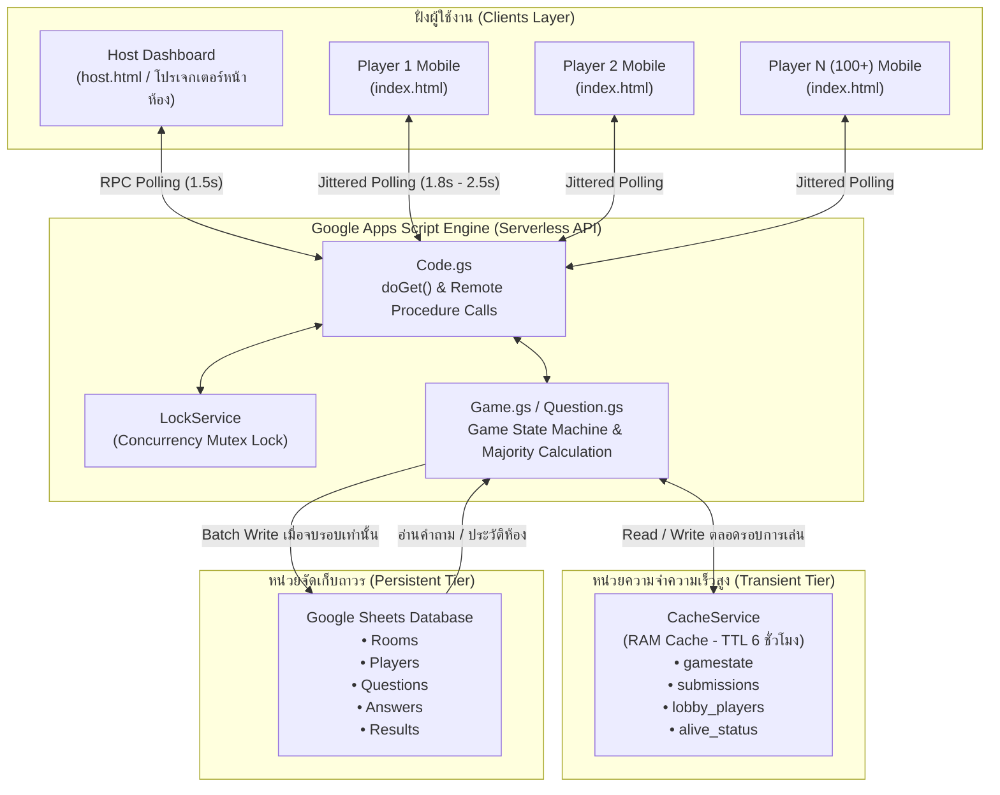
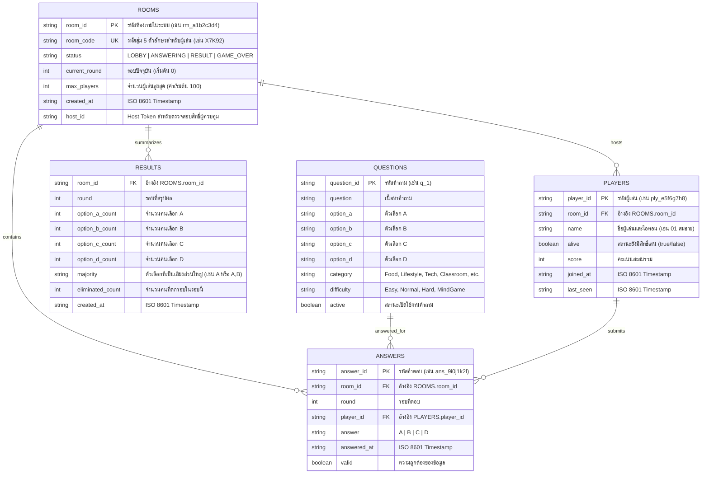
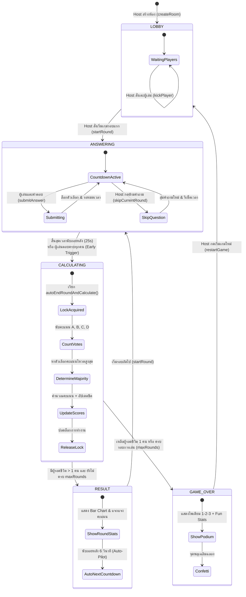

# เอกสารการออกแบบระบบ (System Design Document)
## โปรเจกต์: คิดเหมือนรอด (Majority Rules: Classroom Edition)
**รหัสวิชา:** SO60110 อัตลักษณ์บัณฑิตปัญญาภิวัฒน์ · สถาบันการจัดการปัญญาภิวัฒน์ (PIM)

> **หมายเหตุ:** เอกสารฉบับนี้เป็นเนื้อหาเดียวกับ [DESIGN.md](DESIGN.md) จัดทำขึ้นเพื่อรองรับการอ้างอิงชื่อไฟล์ทั้ง `DESIGN.md` และ `DESING.md`

---

## 1. บทนำและวัตถุประสงค์ (Executive Summary & Objectives)

### 1.1 ที่มาและแนวคิดของเกม (Concept & Pedagogy)
**"คิดเหมือนรอด"** ได้รับการออกแบบขึ้นเพื่อเป็นสื่อการเรียนรู้เชิงปฏิสัมพันธ์ (Interactive Pedagogy) ในรายวิชา SO60110 อัตลักษณ์บัณฑิตปัญญาภิวัฒน์ โดยมุ่งเน้นการเสริมสร้างทักษะความฉลาดทางสังคมและการเข้าอกเข้าใจผู้อื่น (Empathy & Social Awareness) ผ่านเกมแนว **Dilemma Consensus Game**
* ผู้เล่นไม่ได้แข่งขันกันเพื่อค้นหาคำตอบทางวิชาการที่ถูกต้องที่สุด
* แต่ต้องคาดเดาจิตวิทยา ความคิด และบริบททางสังคมของคนรอบข้างในห้องเรียน เพื่อเลือกคำตอบกลุ่มเสียงส่วนใหญ่ (Majority)
* ส่งเสริมการอภิปราย (Debriefing) ต่อในชั้นเรียนว่าทำไมคนส่วนใหญ่ถึงคิดหรือตัดสินใจเช่นนั้น

### 1.2 ความท้าทายทางวิศวกรรมซอฟต์แวร์ (Technical Challenges)
1. **High Concurrency ในชั้นเรียน**: ในคาบเรียนปกติจะมีนักศึกษาเข้าร่วมพร้อมกันตั้งแต่ 50 ถึง 100+ คน ทุกคนส่งคำตอบและดึงข้อมูลพร้อมกันในเสี้ยววินาทีเดียวกัน
2. **ข้อจำกัดของ Google Apps Script & Google Sheets**:
   * Google Sheets มีโควตาและอัตราการเขียนข้อมูลจำกัด (~100 คำขอต่อนาทีต่อผู้ใช้) หากส่งคำขอ `appendRow` หรือ `setValues` จากผู้เล่น 100 คนพร้อมกันทันที ระบบจะล่มจากปัญหา **Quota Exceeded** และ **Lock Timeout**
   * Google Apps Script เป็นสถาปัตยกรรม Request-Response ไร้ WebSocket จำเป็นต้องอาศัยกลไก Polling ที่ไม่ทำให้เซิร์ฟเวอร์รับภาระหนักเกินไป
3. **Zero-Configuration & Zero-Dependency**: ผู้เรียนต้องสามารถเข้าร่วมได้ทันทีผ่านสมาร์ตโฟน โดยไม่ต้องโหลดแอป ไม่ต้องติดตั้งแพ็กเกจเสริม และไม่พึ่งพาไฟล์เสียงขนาดใหญ่ภายนอก

---

## 2. สถาปัตยกรรมระบบโดยรวม (System Architecture)

ระบบถูกออกแบบในลักษณะ **Serverless Hybrid Architecture** โดยผสานการทำงานระหว่าง In-Memory Cache (RAM) บนคลาวด์สำหรับงานที่ต้องการความเร็วสูง และ Google Sheets สำหรับการจัดเก็บข้อมูลถาวร (Persistent Storage)



---

## 3. การออกแบบฐานข้อมูลและหน่วยความจำ (Data Models)

### 3.1 ฐานข้อมูลถาวร: Google Sheets Schema
ฐานข้อมูลประกอบด้วย 5 แผ่นงาน (Relational Sheets) ที่เชื่อมโยงกันด้วยคีย์จำลอง:



### 3.2 การออกแบบคีย์ในหน่วยความจำ RAM (Cache Key Space)
`CacheService.getScriptCache()` ถูกนำมาใช้เก็บ State ที่เปลี่ยนแปลงบ่อยเพื่อลด Latency เหลือต่ำกว่า 5ms:

| คีย์ใน Cache (Key) | ข้อมูลที่จัดเก็บ (Value Payload) | TTL (วินาที) | วัตถุประสงค์ |
|---|---|---|---|
| `room_{roomCode}` | JSON: `{ roomId, roomCode, status, maxRounds, ... }` | 21,600 (6 ชม.) | ค้นหาห้องจากรหัสเข้าห้องได้อย่างรวดเร็ว |
| `room_id_{roomId}` | JSON: ข้อมูลห้องอ้างอิงจาก Room ID | 21,600 | ใช้ตรวจสอบสิทธิ์ `hostToken` และสถานะห้อง |
| `gamestate_{roomId}` | JSON: `{ round, status, question, endTime, ... }` | 21,600 | State หลักที่ไคลเอนต์ทุกคนดึงไปเรนเดอร์หน้าจอ |
| `submissions_{roomId}_{round}` | JSON: `{ [playerId]: { choice, timeLeft } }` | 21,600 | ก้อนคำตอบรวมของรอบนั้น บันทึกแบบ Key-Value |
| `lobby_players_{roomId}` | JSON Array: `[{ id, name, alive }, ...]` | 21,600 | รายชื่อผู้เล่นในห้องสำหรับอัปเดตหน้า Lobby ทันที |
| `alive_{playerId}` | String: `"true"` หรือ `"false"` | 21,600 | ตรวจสอบสถานะการรอดชีวิตรายบุคคลแบบ O(1) |
| `score_breakdown_{roomId}_{round}_{playerId}` | JSON: `{ survived, baseScore, speedScore, totalScore }` | 21,600 | รายละเอียดคะแนนเฉพาะตัวสำหรับแสดงในหน้าสรุปผล |
| `leaderboard_{roomId}` | JSON Array: รายชื่อผู้เล่นเรียงตามคะแนนสูงสุด | 21,600 | สำหรับเรนเดอร์แท่นโพเดียมและตารางอันดับ |
| `used_q_{roomId}` | JSON Array: `["q_1", "q_15", ...]` | 21,600 | ป้องกันการสุ่มคำถามซ้ำในห้องเดิมตลอดการแข่งขัน |

---

## 4. แผนผังวงจรสถานะของเกม (Game State Machine)

วงจรสถานะของเกมถูกควบคุมอย่างเคร่งครัดผ่านสถานะใน `CONFIG.GAME_STATES`:



### รายละเอียดเงื่อนไขการเปลี่ยนสถานะ (Transition Rules):
1. **LOBBY → ANSWERING**: เกิดขึ้นเมื่อ Host กดปุ่มเริ่มรอบ โดยระบบจะสุ่มคำถามใหม่จากคลังที่ยังไม่เคยใช้ กำหนดเวลาสิ้นสุด `endTime = now + 25s`
2. **ANSWERING → CALCULATING**:
   * *เงื่อนไขปกติ*: เวลาคงเหลือ $\le 0$
   * *Early Auto-Calculate*: จำนวนคนตอบใน Cache (`submissions`) เท่ากับจำนวนคนที่ยังมีสิทธิ์เล่น (`totalAliveInRoom`) ระบบจะส่งสัญญาณ `isAllAnswered = true` และเริ่มประมวลผลทันทีโดยไม่ต้องรอให้ครบ 25 วินาที
3. **CALCULATING → RESULT หรือ GAME_OVER**:
   * หากมีผู้รอดชีวิตเหลือเพียงคนเดียว $\rightarrow$ `GAME_OVER` ทันที (Last Man Standing)
   * หากจบรอบที่ตรงกับ `maxRounds` $\rightarrow$ `GAME_OVER`
   * กรณีอื่นๆ $\rightarrow$ `RESULT`
4. **RESULT → ANSWERING**:
   * หากเปิด **Auto-Pilot** (เปิดเป็นค่าเริ่มต้น) ไคลเอนต์ Host จะนับถอยหลัง 6 วินาทีแล้วเรียก `startRound()` อัตโนมัติ

---

## 5. กลยุทธ์การรองรับการทำงานพร้อมกันสูง (Concurrency & Resilience Strategy)

### 5.1 การหลีกเลี่ยงปัญหา Google Sheets Lock Contention
ปัญหาใหญ่ที่สุดของ Google Apps Script คือการที่หลายไคลเอนต์แย่งกันเขียนชีตพร้อมกัน โค้ดของโปรเจกต์นี้แก้ปัญหาด้วย **3 กฎเหล็ก**:

1. **ห้ามเขียนลง Sheet ระหว่างกำลังรับคำตอบ**:
   เมื่อผู้เล่นกดยืนยันคำตอบ ฟังก์ชัน `submitAnswer` จะเขียนลงใน `CacheService` เพียงอย่างเดียว โดยใช้ `LockService.getScriptLock()` ด้วยเวลารอเพียง 3 วินาที ทำให้การประมวลผลต่อ Request ใช้เวลาไม่ถึง 20ms
2. **ประมวลผลและเขียนฐานข้อมูลแบบครั้งเดียวจบ (Batch Write)**:
   เมื่อจบรอบ ฟังก์ชัน `autoEndRoundAndCalculate` จะอ่านข้อมูลผู้เล่นทั้งหมดมาไว้ใน Array ของ JavaScript ทำการอัปเดตคะแนนและสถานะใน RAM แล้วสั่ง `setValues()` และ `appendRow()` ลงใน Sheets เพียง 1-2 คำสั่งต่อรอบ
3. **Idempotency Protection**:
   ก่อนที่ฟังก์ชันคำนวณผลจะเริ่มทำงาน มีการตรวจสอบสถานะ `if (state.status === "RESULT" || state.status === "GAME_OVER") return;` เพื่อป้องกันกรณีที่คำขอสรุปผลถูกยิงซ้ำสองครั้ง

### 5.2 การกระจายภาระงานด้วย Jittered Polling
แทนที่ผู้เล่นทุกคนจะยิง Request ทุกๆ 2 วินาทีพร้อมกันเป็นระเบียบ (ซึ่งจะทำให้เซิร์ฟเวอร์โดน Spike โหลดทุกๆ 2 วินาที) ฝั่ง Client ใน `index.html` จะใช้สูตรสุ่มความแปรปรวนของเวลา:

$$\text{Polling Interval} = 1800\text{ms} + \text{random}(0, 700\text{ms})$$

ผลลัพธ์คือคำขอจากผู้เล่น 100 คนจะกระจายตัวสม่ำเสมอในทุกเสี้ยววินาที ทำให้เซิร์ฟเวอร์ทำงานได้อย่างราบรื่นและไม่เกิดสภาวะ Thundering Herd

---

## 6. อัลกอริทึมและตรรกะการคำนวณคะแนน (Scoring & Mathematics)

### 6.1 การตัดสินเสียงส่วนใหญ่ (Majority Determination)
ในแต่ละรอบ ระบบจะนับผลรวมการโหวต $V_c$ ของแต่ละตัวเลือก $c \in \{A, B, C, D\}$:

$$V_{max} = \max(V_A, V_B, V_C, V_D)$$

เซตของตัวเลือกที่เป็นเสียงส่วนใหญ่ $\mathcal{M}$ นิยามดังนี้:

$$\mathcal{M} = \{ c \in \{A, B, C, D\} \mid V_c = V_{max} \land V_{max} > 0 \}$$

> **หมายเหตุ:** หาก $V_A = 20, V_B = 20, V_C = 5, V_D = 2$ ตัวเลือกที่เป็นเสียงส่วนใหญ่คือทั้ง $\{A, B\}$ ผู้เล่นที่เลือก A หรือ B จะรอดชีวิตทั้งคู่

### 6.2 สูตรการคำนวณคะแนน (Point Formula)
สำหรับผู้เล่น $p$ ที่มีสถานะรอดชีวิตและส่งคำตอบ $c_p$:
* หาก $c_p \in \mathcal{M}$:
  * ผู้เล่น **รอดชีวิต (Survived)**
  * ได้รับคะแนนฐาน: $S_{base} = 1,000$
  * ได้รับโบนัสความเร็ว: $S_{speed} = T_{remain} \times 10$  
    *(โดย $T_{remain}$ คือเวลาคงเหลือในหน่วยวินาที ณ ขณะที่ส่งคำตอบ)*
  * คะแนนสะสมใหม่: $Score_{total} = Score_{prev} + S_{base} + S_{speed}$
* หาก $c_p \notin \mathcal{M}$ หรือไม่ได้ส่งคำตอบ:
  * ผู้เล่น **ตกรอบ (Eliminated)**: `alive = false`
  * ได้รับคะแนนรอบนี้: $0$ แต้ม
  * คะแนนสะสมคงเดิม: $Score_{total} = Score_{prev}$

---

## 7. การออกแบบระบบ UI/UX และระบบเสียง (Interface & Audio Design)

### 7.1 อัตลักษณ์การออกแบบ: Russian Roulette ✕ Authentic Casino Playing Cards
ระบบนำเสนอสุนทรียศาสตร์ของ **ห้องเดิมพันรัสเซียนรูเล็ตต์ผสานสำรับไพ่คาสิโนระดับพรีเมียม (High-Stakes Russian Roulette & Casino Cards)** เพื่อสร้างความตื่นเต้น ระทึกขวัญ และดึงดูดผู้เรียนให้มีส่วนร่วมตลอดทั้งคาบเรียน:

```
+-----------------------------------------------------------------------+
|  [ CHAMBER ROUND 1/6 · RUSSIAN ROULETTE CONSENSUS ]          ♠ ♥ ♦ ♣  |
|                                                                       |
|  รอบที่ 1/5  [ 🔫 (•)(•)(•)(•)(•)(•) ]                ⏱️ 25 SEC       |
|                                                                       |
|  +-----------------------------------------------------------------+  |
|  | คำถาม: หากต้องเลือกของขวัญวันเกิดให้เพื่อนสนิท คุณจะเลือกอะไร?  |  |
|  +-----------------------------------------------------------------+  |
|                                                                       |
|  [ A ♠ ]  นาฬิกาข้อมือ        [ B ♥ ]  ตั๋วคอนเสิร์ตที่ชอบ      |
|  [     ]  (Ivory Card Face)    [     ]  (Casino Crimson Card)   |
|                                                                       |
|  [ C ♦ ]  เซตของขวัญ DIY       [ D ♣ ]  พาไปเลี้ยงบุฟเฟต์หรู     |
|  [     ]  (Casino Crimson Card) [     ]  (Jet Obsidian Card)    |
+-----------------------------------------------------------------------+
```

#### ก. พื้นผิวและบรรยากาศ (Surfaces & Materials)
* **Casino Poker Felt Table Canvas**: พื้นหลังจำลองโต๊ะผ้าสักหลาดสีเขียวป่าสนลึก (`radial-gradient` โทน `#15462c` ถึง `#020c07`) พร้อมเทกซ์เจอร์ลายทอผ้าสักหลาดขนาด 20px
* **Mahogany & Brass Gilded Rim**: กรอบตู้คอนเทนเนอร์ล้อมด้วยเนื้อไม้ Mahogany เข้ม (`#1c130c`) ตีเส้นขลิบทองเหลืองขัดเงา Brass Gold (`#d4af37`) พร้อมลวดลายดอกไพ่ทองคำ `♠ ♥ ♦ ♣`
* **Brass Telemetry Plaque**: ป้ายสถานะหัวกระดานสไตล์แผ่นป้ายทองเหลือง `[ CHAMBER ROUND · RUSSIAN ROULETTE CONSENSUS ]`

#### ข. กายวิภาคของหน้าไพ่สากล (Authentic Playing Card Anatomy)
ตัวเลือกทั้ง 4 ตัวเลือก (A, B, C, D) ถูกสร้างขึ้นตามแบบแผนสำรับไพ่คาสิโนระดับสากล 100%:
1. **Ivory Linen Cardstock Face**: เนื้อกระดาษไพ่สีขาวงาช้างประกายมุก (`linear-gradient(155deg, #ffffff 0%, #faf7f0 55%, #f2ece0 100%)`) พร้อมขอบโค้งมนตามอัตราส่วนการ์ดจริง
2. **Dual Corner Indices (ดัชนีหัว-ท้ายไพ่)**:
   * **มุมบนซ้าย**: ตัวอักษร Rank ตัวหนาคมชัดเหนือสัญลักษณ์ดอกไพ่ (`A ♠`, `B ♥`, `C ♦`, `D ♣`)
   * **มุมล่างขวา**: Rank + ดอกไพ่แบบ **หมุนกลับหัว 180 องศา** ตามมาตรฐานหน้าไพ่ของแท้
3. **Double Hairline Filigree Frame**: กรอบเส้นประดับคู่ขอบใน (Inset 6px, Outline Offset -3px) ตกแต่งตามโทนสีดอกไพ่
4. **Large Center Suit Watermark**: ดอกไพ่ลายน้ำขนาดใหญ่ความโปร่งแสง 12% ซ้อนอยู่กึ่งกลางด้านหลังข้อความคำตอบ
5. **Authentic Suit Colors**:
   * **โพดำ (♠ Spades) & ดอกจิก (♣ Clubs)**: สี Jet Obsidian Black (`#111827`)
   * **โพแดง (♥ Hearts) & ข้าวหลามตัด (♦ Diamonds)**: สี Vivid Casino Crimson Red (`#dc2626`)
6. **Tactile 3D Card Physics**: การจำลองการหยิบไพ่ลอยขึ้นจากโต๊ะสักหลาด (Card Lift & Natural Tilt) โดยไพ่ฝั่งซ้ายเอียง `-1.2deg` และไพ่ฝั่งขวาเอียง `+1.2deg` เมื่อวางเมาส์หรือสัมผัส

#### ค. สถาปัตยกรรมรังเพลิงลูกโม่ (Revolver Cylinder HUD)
* **6-Chamber Gunmetal Cylinder**: วิดเจ็ตรังเพลิงปืนลูกโม่ 6 นัด ผลิตจากโลหะ Gunmetal สลับเบ้าปลอกกระสุนทองเหลือง
* **Active Chamber Pulse**: รังเพลิงนัดที่จะสับไกในรอบปัจจุบัน เรืองแสงเป็นชีพจรสีทอง/แดง (`chamberPulse`)
* **Spent Chamber Casing**: รังเพลิงที่ถูกยิงผ่านไปแล้วจะแสดงเป็นเบ้ากระสุนเปล่ามืดดับ
* **Russian Roulette Drama States**:
  * **Survived (รอดชีวิต)**: แบนเนอร์สีเขียวมรกตพร้อมข้อความ `⚪ CLICK! รังเพลิงว่าง — คุณรอดชีวิต!` (นกสับฟาดลงบนรังเพลิงว่าง)
  * **Eliminated (ตกรอบ)**: แบนเนอร์สีแดงเลือดนกพร้อมข้อความ `💥 BANG! โดนกระสุนจริง — ตกรอบสู่โหมดผู้ชม!` พร้อมเอฟเฟกต์หน้าจอสั่นกระตุก (`gunshotShake`)

### 7.2 ระบบเสียงจำลองสถานการณ์ระทึก (Web Audio Synthesizer Engine)
เพื่อตัดปัญหาการโหลดไฟล์ `.mp3` ซึ่งอาจล่าช้าเมื่อสัญญาณอินเทอร์เน็ตในห้องเรียนติดขัด ระบบจึงใช้ **Web Audio API** สร้างคลื่นเสียงแบบเรียลไทม์จาก JavaScript โดยตรง:
* **Revolver Ratchet Spin**: เสียงหมุนรังเพลิงลูกโม่รูเล็ตต์ 6 คลิกจำลองกลไกเฟืองปืนลูกโม่ก่อนเริ่มรอบ
* **Blank Chamber Click**: เสียงสับไกแห้งโลหะเมื่อกระสุนด้าน/ผู้เล่นรอดชีวิต
* **Sub-Bass Gunshot Blast**: คลื่นเสียงความถี่ต่ำ (Sub-bass punch) ผสม White Noise Decay จำลองเสียงปืนระเบิดเมื่อผู้เล่นตกรอบ
* **Casino Chip Clink**: เสียงชิปคาสิโนกระทบกันความถี่ 2,400Hz - 3,200Hz เมื่อได้รับคะแนน
* **Countdown Danger Ticks**: เสียงเคาะจังหวะเร่งเร้าใน 5 วินาทีสุดท้ายก่อนหมดเวลารอบ
* **Audio Unlocking Overlay**: เบราว์เซอร์สมัยใหม่ (โดยเฉพาะ iOS Safari และ Chrome Mobile) จะบล็อกเสียงอัตโนมัติหากผู้ใช้ยังไม่ได้สัมผัสหน้าจอ ระบบจึงมีหน้าต่างปลดล็อกเสียง (Audio Unlock Modal) ตั้งแต่เริ่มโหลด

### 7.3 กลยุทธ์การรองรับทุกขนาดหน้าจอ (Omni-Device Responsiveness: 320px ถึง 4K Projector)
ระบบออกแบบด้วยหลักการ **Fluid Scalable & Touch-First Architecture** เพื่อการันตีการแสดงผลอย่างไร้รอยต่อในทุกอุปกรณ์ของผู้เรียนและผู้สอน:

1. **Ultra-Compact Mobile (≤350px - เช่น iPhone SE 1st Gen, Galaxy Fold Cover Screen):**
   * ปรับขนาดการ์ดอัตโนมัติด้วย CSS `clamp()` ลดระยะห่างเหลือ 6px
   * **เทคนิค Dynamic Pip Hiding**: ซ่อนดัชนีมุมล่างขวาอัตโนมัติบนหน้าจอแคบพิเศษ เพื่อสงวนพื้นที่ 100% ให้ตัวอักษรคำตอบภาษาไทยไม่ล้นหรือตัดทอน
   * ปรับปุ่มชิป Avatar เป็น Grid 3x2 พร้อมขนาด Touch Target ที่แตะได้ถนัดด้วยนิ้วหัวแม่มือ
2. **Modern Smartphones (351px - 520px - เช่น iPhone 13/14/15/16, Samsung Galaxy S Series):**
   * Layout การ์ดแบบ 2x2 Portrait Grid รักษาอัตราส่วนไพ่สากลเสมือนผู้เรียนกำลังถือไพ่ 4 ใบอยู่ในมือจริง
   * รองรับ Safe Area Insets (`env(safe-area-inset-top)` / `bottom`) สำหรับขอบ Dynamic Island และ Home Indicator
   * ใช้ Dynamic Viewport Height (`100dvh`) เพื่อป้องกันการกระตุกเมื่อแถบ URL Bar บน Safari / Chrome เลื่อนขึ้นลง
3. **Tablets & iPads (521px - 840px - เช่น iPad Mini, iPad Air, Galaxy Tab):**
   * ขยายความกว้างตู้เกมอัตโนมัติสู่ `width: min(100%, 820px)` เพิ่มพื้นที่ระยะเว้นวรรคให้อ่านโจทย์และตัวเลือกยาวๆ ได้อย่างสบายตา
4. **Classroom Theater / Projector Mode (≥1200px และปุ่มโหมดโปรเจกเตอร์):**
   * ขยายความกว้างคอนเทนเนอร์สูงสุดสู่ `1400px` บนจอโปรเจกเตอร์หน้าห้องเรียน
   * ตัวอักษรคำถามและหน้าไพ่ขนาดมหึมา (Giant High-Visibility Cards: ความสูงไพ่ 15rem, ตัวอักษรคำถาม 2.2rem - 2.6rem) ที่นักศึกษาหลังห้องระยะ 15-20 เมตรสามารถอ่านได้ชัดเจนแจ่มแจ้ง
   * ปรับขนาดโพเดียมโอลิมปิกและบาร์คะแนนให้เห็นมวลชนโหวตอย่างตระการตา

---

## 8. ความปลอดภัยและการกู้คืนระบบ (Security & Fault Tolerance)

1. **Host Authentication via Host Token**:
   การกระทำระดับผู้ดูแลห้อง (เริ่มรอบ, ข้ามข้อ, เตะผู้เล่น, รีเซ็ตเกม) จะต้องส่ง `hostToken` ที่สร้างแบบสุ่มตั้งแต่ตอนสร้างห้องแนบไปด้วยเสมอ เซิร์ฟเวอร์จะปฏิเสธคำสั่งทันทีหาก Token ไม่ตรงกัน ป้องกันไม่ให้ผู้เรียนแอบยิงคำสั่งก่อกวน
2. **ป้องกัน Cross-Site Scripting (XSS)**:
   ข้อความชื่อผู้เล่นและเนื้อหาคำถามที่ถูกนำไปแสดงผลใน DOM จะถูกกรองผ่านฟังก์ชัน `escapeHtml()` เพื่อแปลงอักขระพิเศษ เช่น `<, >, &, "` ป้องกันการฝังโค้ดอันตราย
3. **Session Recovery ผ่าน LocalStorage**:
   ทั้งฝั่ง Host (`host_session_backup`) และ Player (`game_session_backup`) มีการบันทึกสถานะห้อง รหัสผู้เล่น และโทเคนลงใน `localStorage` ของเบราว์เซอร์ หากผู้เล่นเผลอปิดหน้าจอหรือสลับแอป เมื่อเปิดกลับมาจะสามารถเล่นเกมต่อได้ทันทีโดยไม่ต้องเข้าห้องใหม่
4. **Host Emergency Controls**:
   * หากมีคำถามไม่เหมาะสม หรือนักศึกษาทักท้วง Host สามารถกด **"ข้ามคำถามนี้ (Skip Round)"** เพื่อสุ่มข้อใหม่ทันที
   * หากมีผู้เรียนตั้งชื่อไม่เหมาะสม สามารถคลิกเครื่องหมายกากบาท **[×]** ข้างชื่อในหน้ารายชื่อเพื่อเตะออกจากห้องได้ทันที

---

## 9. สรุปและแนวทางการต่อยอดในอนาคต (Future Enhancements)

| ด้าน | สถานะปัจจุบัน | แนวทางการพัฒนาต่อยอดในอนาคต |
|---|---|---|
| **การเชื่อมต่อ** | HTTP Polling (1.5s - 2.5s) | เชื่อมต่อ Firebase Realtime Database หรือ WebSocket Server ภายนอกเพื่อการซิงก์ระดับ Real-time ต่ำกว่า 100ms |
| **คลังคำถาม** | คลังคำถามตายตัว 50 ข้อใน Sheets | เพิ่มหน้า UI ให้ผู้สอนสามารถสร้าง แก้ไข หรือนำเข้าไฟล์ CSV คำถามได้เองจากหน้าเว็บ |
| **การวิเคราะห์ผล** | แสดงบาร์ชาร์ตและตารางอันดับ | ระบบส่งออกรายงานสถิติ (Export Report PDF / CSV) สำหรับประเมินผลคะแนนกิจกรรมของนักศึกษา |
| **โหมดการเล่น** | Majority Survival เดี่ยว | เพิ่มโหมดทีม (Team Consensus) และโหมด Reverse (เลือกเสียงส่วนน้อย / Minority Win) |

---
*เอกสารนี้จัดทำขึ้นสำหรับโปรเจกต์ "คิดเหมือนรอด" รายวิชา SO60110 อัตลักษณ์บัณฑิตปัญญาภิวัฒน์*
